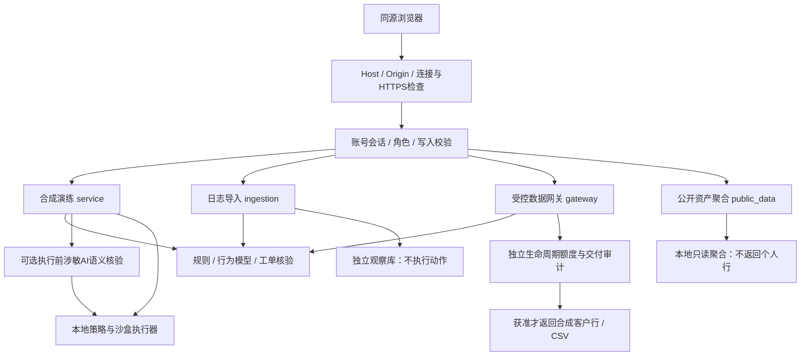

# DataFence 架构与边界：Windows 私有部署版

本页于2026-09-19按当前源码更新。此前v0.1中“只能本机无账号演示、没有真实认证、所有输入都是生成数据”的架构描述已被替代（superseded）。当前提供Windows本机或显式HTTPS内网部署、持久账号与角色、合成银行资产的受控查询/CSV交付、独立日志观察和公开数据聚合。银行业务资产仍是合成数据；UCI为独立公开业务数据，不能据此声称对接银行生产系统或验证真实外泄检测效果。HTTP字段见 [API_CONTRACT.md](API_CONTRACT.md)，安装和运维见 [DEPLOYMENT_WINDOWS.md](DEPLOYMENT_WINDOWS.md)。

## 请求路径与执行边界

共享检测器只输出分数、理由和动作建议；是否实际执行由调用路径决定，图中的三条安全处理路径不能相互代替证据：

| 路径 | 输入与历史 | 动作与数据交付 | 云模型 |
| --- | --- | --- | --- |
| 合成演练 | 固定场景生成的事件；每个run独立 | 按当前前缀裁定，沙盒物化合成对象；冻结或父对象未生成时截断后续步骤 | 配置后可调用；涉敏AI语义门执行前，附加解释执行后 |
| JSONL/CSV导入 | 显式合成日志；每批独立，不跨批累计 | observe，只保存检测建议；不执行动作、不扣额度、不能撤销已经发生的操作 | 从不调用 |
| query/export网关 | 已登录操作员选择共享合成工单；真实服务时钟；恢复操作员+工单持久历史 | 先检查工单、检测策略、冻结和额度；持久裁定后获准才返回客户行/CSV | 从不调用 |

导入的analysis.blocked不表示实际阻断；网关allowed=false且零交付和演练执行器outcome才是各自路径的控制结果。网关CSV交付到已登录浏览器，没有任意SQL、URL、服务端目标路径或真实银行连接器。模拟UPLOAD只写本地接收账本，不产生外网连接。当前AI_PROMPT沙盒不生成下游模型回答，涉敏请求拦截不等于对真实模型输出完成DLP验证。

## 模块职责

- `models.py`：字段白名单、额外字段拒绝；SecurityEvent不接受ground_truth、attack_type等答案。
- `sandbox.py` / `scenarios.py`：合成银行、工单、六个异常场景及正常/批准批量对照；分别返回事件和标签。应用新库默认50,000客户，已有库保持实际内容。
- `engine.py`：规则、Isolation Forest、工单目的/范围/时间核验、会话与对象关联；加载有效本地模型，输出建议；commit_analysis同步策略修正后的历史。模型无执行权限。
  工单已观察读取量按员工/会话/工单独立累计，不随30分钟/127条上下文裁剪而消失；仅用作工单证据，持久成功执行额度仍由QuotaLedger管理。active晋升摘要必须完整合法，缺失/不匹配明确降级。
- `service.py` / `execution.py`：演练调度、语义门和额度编排、执行前控制、合成对象依赖与事件保存。银行实体在服务生命周期内不变，启动时对持久实体实际COUNT一次，overview/assets复用计数；事件统计仍读取持久事件。
- `gateway.py`：实际HTTP合成行交付、当前工单权限复核、持久历史与冻结、actor+request_id幂等、网关独立SHA-256链；只接受合成客户资产。
- `quota.py` / `quota_policy.py`：事务内检查并预留申请记录数；reserved与confirmed均占用容量，本地策略落实超限拒绝。
- `ingestion.py`：限制大小/行数、严格解析、员工/工单映射、批次原子保存与幂等；独立观察库。
- `public_data.py`：固定官方UCI来源、下载/解包资源限制与摘要核验、质量统计、只读聚合。CERT研究归档未作为可用检测基准。
- `auth.py`：本地账号、scrypt密码哈希、持久会话摘要、撤销和登录速率限制。
- `deployment.py` / `server.py` / `api.py`：本机/内网策略、TLS启动、Host/Origin、角色与写入校验、请求资源限制、API和同源前端。
- `runtime_lock.py` / `maintenance.py`：运行目录排他文件锁、离线SQLite快照、摘要/库完整性检查、仅向新目录恢复并清除恢复会话。
- `storage.py`：合成实体、演练、事件、接收账本和评测作业；演练各自维护证据链。
- `llm.py` / `sensenova.py` / `prompt_policy.py`：可选本地解释、授权商汤分析、纯策略语义裁定；credentials.py使用当前Windows用户DPAPI，llm_budget.py记录调用与token预留。
- `training.py` / `model_artifacts.py`：独立本地行为训练、校准、留出评测、门槛晋升、安全JSON森林加载和旧版回退。商汤API调用不是训练其模型权重。
- `evaluation.py` / `challenge.py`：完整离线流的可重算评测与开发诊断，不负责实时交付控制。`frontend/`区分实际API状态、检测建议和执行结果。

## 身份与网络边界

默认local+required：回环连接、Host白名单、浏览器Origin和跨站限制之外，还必须登录。无产品默认账号，首个管理员仅能在本机local模式初始化；LAN启动前必须已有账号。LAN配置明确Host和精确HTTPS Origin，服务直接终止TLS，不信任X-Forwarded-*，HTTP拒绝；不启用通配CORS。local_demo是显式本机兼容测试选项，推荐启动器强制required，LAN禁止该豁免。

密码使用固定有界scrypt参数和独立随机盐；持久化密码哈希及会话摘要，不保存明文会话值。会话默认8小时，cookie为HttpOnly、SameSite=Strict，LAN另加Secure；写操作需独立会话校验值。普通重启保留未过期会话；改密、角色或启用状态实际变化撤销已有会话，重新启用不复活旧会话。最后一个可用admin不能被禁用或降级。按用户名/IP在SQLite中预占登录尝试，哈希并发有界；这些不等同于银行SSO、MFA或企业IAM。

admin管理账号并操作业务；analyst可创建演练、评测、导入和网关请求；viewer只读且可注销自身会话。三者共享平台数据，**没有租户隔离、账号到业务员工的绑定、逐工单对象ACL或独立评测权限角色**。网关employee来自选定合成工单，actor记录实际平台操作员；不能声称验证了真实银行员工身份。

一般写请求JSON上限16KiB，导入JSON外层2MiB、内容UTF-8上限1MiB、最多2000条。导入拒绝答案字段，不把输入解释为文件路径或执行代码，约定仅接受合成日志；显式synthetic标记是输入约束，不是对恶意客户端填入内容真实性的证明。网关每请求最多5000条、32个区域；每actor+task最多500条持久操作。演练最多并发3个、离线评测1个。推荐服务单进程，Uvicorn应用并发上限64、keep-alive 5秒、优雅停机窗口90秒；这些限制不是容量或延迟保证。

## 存储、额度与恢复

默认根目录为runtime，可用专用data_dir隔离部署与验收。服务持有该目录的操作系统文件锁，阻止第二个遵守该协议的服务/备份任务同时占用；这不是防止本机管理员直接修改文件的安全隔离。

| 位置（相对data_dir） | 内容与边界 |
| --- | --- |
| `datafence.sqlite3` | 合成实体、演练事件/回执、评测作业；overview仅统计该演练事件库，不合并导入或网关 |
| `auth.sqlite3` | 账号哈希、会话摘要、登录尝试；用户API不返回秘密字段 |
| `imports.sqlite3` | 批次、观察记录、来源事件去重；无执行副作用 |
| `quota.sqlite3` | 演练session/task_lifetime额度 |
| `gateway.sqlite3` | actor/request_id去重、交付裁定、客户标识、内部检测事件、独立证据链 |
| `gateway-quota.sqlite3` | 网关独立、强制task_lifetime额度，不与演练混用 |
| `public-data/` | 公开源压缩包、来源/质量manifest、仅聚合catalog.sqlite3；不进入customers、检测训练或云 |
| `evaluation_labels/`、`evaluations/` | 独立演练标签、冻结测试事件/标签/预测/报告，业务HTTP不暴露答案 |
| `models/` | 本地行为模型安全JSON产物及校验元数据 |
| `llm-budget.sqlite3` | 调用次数及已计量/保守预留token；不是供应商余额 |
| `logs/`、`server-state.json` | 轮转日志、实际PID/目录/端口；不是可信外部审计或进程身份复核的替代品 |

额度指标为accepted_request_records：获准读取的申请record_count，不是去重客户、实际返回数或外泄量。演练QUERY/API扣额，导出/压缩/上传不重复扣同一读取。网关每次query或export都包含新读取，按申请数扣一次；task+employee生命周期桶跨操作员、浏览器和重启共享，导出子事件不重复扣额。not_applicable计数为null，不能显示为0或耗尽。

网关幂等键是actor身份+request_id；同请求不重复扣额，改参数409。重放获准结果仍复核当前授权窗口、持久冻结与网关链，否则不交付旧数据。额度和交付审计分属两个SQLite库，**没有跨库原子提交**。先保留/确认额度，再写交付回执；全部成功才组装HTTP客户行/CSV。中间崩溃可能占额但没有交付；发现缺回执的既有额度时409 unresolved_reservation，不能自动退款或重复交付，须结合证据处理。

重启把旧running演练/评测标interrupted，不假称完成或自动重跑。演练创建支持Idempotency-Key。离线备份需停止所有写入任务，持有运行目录锁后通过SQLite backup API和文件摘要生成快照；只恢复到不存在的新目录，并清除旧登录会话。快照可能含密码哈希及DPAPI密文，应与运行目录同等保护；换机器/Windows身份可能需要重新配置密钥。这里描述实现，实际恢复与TLS验收以VALIDATION和专门报告为准。

## 模型与证据边界

检测只接收可观察字段和已处理前缀，不接收标签、scenario_id或run_id；训练、校准和独立评测产物分开。标签与检测接口是应用层逻辑隔离，仍在同一操作系统身份下；没有独立检测账号、容器或数据库角色阻止读取标签。未来拆分需真实权限拒绝测试，不能将目录文件锁称为标签OS隔离。

Ollama沿用高风险后的只读解释。商汤配置后，对涉敏AI_PROMPT执行前核验，不依赖旧风险阈值；原文证据和结构由纯策略复验，unsafe+execute可触发本地BLOCK_AI_PROMPT，safe只能在严格条件下解除单关键词误阻断。失败/不确定暂缓该请求，不因此增加恶意分或冻结。其他高风险事件每演练最多两次事后解释，解释失败不撤销已完成控制。模型不能直接执行动作；模拟SOC通知等建议也不表示接入了真实外部系统。

商汤网络阶段有40秒总截止（连接、响应头、响应体），无自动重试；输出上限2400 tokens、temperature=0.2。预算不可用拒绝新调用，未知消耗保守预留；上下文准备、预算事务和校验不在网络截止内。只保存校验后的结构化结果、请求标识、正文摘要和脱敏元数据，不保存隐藏推理或原始错误正文。公开业务个人行、凭据及评测答案不进入云上下文。

新演练记录区分received_at、detected_at、execution_completed_at/responded_at、ai_completed_at、persisted_at；语义等待发生在执行前，事后解释等待不混入执行器完成耗时。事件timestamp还可能来自合成时间轴，不能混称真实响应延迟。

演练证据链及模拟接收摘要由/api/audit/verify检查；网关有独立/api/access/verify。空演练链有效不代表网关有效。SHA-256只能发现未同步重算的修改，不提供外部签名、可信时间戳或对抗本机管理员重写全链的保证；普通导入没有同等哈希链。公开源摘要也是已固定源的一致性检查，不是发布方签名。

效果主张必须引用对应产物：固定模板基线、公开挑战、行为模型留出集和商汤三轮公开回归口径不同，回归100%不能外推真实攻击。UCI营销目标不是攻击标签；CERT r1研究归档尚有嵌入许可限制和匹配标签缺口，未进入训练或评测。实际HTTP验收见 [PRIVATE_ACCEPTANCE.md](PRIVATE_ACCEPTANCE.md)，短时本机延迟不能外推内网长期容量。银行IAM/真实数据源、外部DLP、MFA/多租户、外部可信审计、高可用与长期负载能力仍未完成。
