# 工银数界 DataFence：给后续 GPT 的项目总说明

> 更新日期：2026-10-06。本文是理解项目的入口，不是实验报告，也不取代源码。**接手本项目前先读 [PROJECT_CONTEXT.md](PROJECT_CONTEXT.md) 和 [AGENTS.md](AGENTS.md)**；本文解释“为什么做、已经做成什么、怎样工作、证据在哪里、还缺什么”。若文档与代码不一致，核对当前代码、测试和运行产物，再修正文档；不得把历史计划当成现状。

## 1. 一句话与起源

**DataFence 是面向大型商业银行数据安全场景的可运行概念验证系统：在合成银行里验证“账号有权限，不等于这一次访问有合理业务目的”，并用可追溯的证据决定合成数据是否交付。**“工银数界”是项目名称与参赛定位，不表示工商银行已经采用、部署或提供了数据。

项目起点是用户提供的 [PROJECT_CONTEXT.md](PROJECT_CONTEXT.md)：围绕工行杯金融科技创新竞赛的金融安全服务方向，提出目的感知访问、行为异常检测、数据流追踪和多能力协同的设计。之后用户明确要求它不能只是流程图或演示页面：要有业务人员与安全分析员分开的日常工作台、真实有效的本地功能、可重复实验、Windows 本机/内网可部署、公开数据与合成银行数据、商汤模型接入、攻击训练，以及专业角色评审和持续整改。因此现在的首要目标是**诚实、可运行、可验证的本地 PoC**，不是对银行生产效果或竞赛获奖作承诺。

核心问题可以用一个例子理解：某员工能登录并读取客户资料，但一次夜间从新设备、用过期工单、跨区申请大量客户数据并尝试外发的操作，不能仅凭“账号能登录”就放行。反过来，拥有有效审批的批量对账可能非常大，不能仅凭“大批量”就判断是攻击。系统同时检查 **谁（身份/设备）、看什么（敏感度/范围）、为什么（工单/目的）、怎么做（时间/频率/渠道）、去了哪里（对象流转/接收回执）**。

对业务侧，它在交付合成客户行前执行工单和额度控制；对安全侧，它把风险、业务依据、是否实际交付、人工研判和证据串到同一事件上；对研究/比赛侧，它把规则、行为模型、云语义分析及不同数据集的实验口径分开，允许复现成功和失败。其主张是对现有身份管理、审计、DLP/SOC 思路增加“本次业务意图与跨事件证据”这一验证切口，并不暗示任何银行现有体系缺少这些能力。

## 2. 系统边界与事实等级

| 分类 | 当前事实与可使用的说法 | 不能推断成什么 |
| --- | --- | --- |
| 银行业务 | 员工、工单、客户、账户、交易等由程序生成；业务网关确实查询/导出这些合成客户行 | 真实银行客户、真实工行内网或生产 DLP 接入 |
| 公开数据 | UCI Bank Marketing 单独记录来源和汇总；它的 `y` 是营销结果 | 银行安全攻击标签、真实访问日志 |
| 沙盒攻击 | 六类异常剧本、两个正常对照，在自建环境产生事件与本地模拟接收回执 | 对真实银行网络、账户、接口的攻击测试 |
| 日志导入 | 严格解析合成观察记录并事后研判 | 对外部系统完成了执行前阻断 |
| 商汤 | 可选地对裁剪过的合成安全上下文做语义核验/解释，有真实调用诊断 | 训练或微调了商汤权重、每个事件都调用成功 |
| 人工研判与审计 | 本地持久化版本、摘要链、执行状态和回执 | 第三方不可抵赖签名、自动解除控制、向外部 SOC 真正发信 |

所有涉及“准确率、召回率、误报率、延迟”的数字都必须附带**数据集、样本量、口径、版本、实验日期和来源产物**。历史报告中的结果不自动成为当前版本或真实银行结果。`ground_truth`、`attack_type`、场景 ID 等答案字段只供独立评测；检测输入、九维特征、知识检索和云模型上下文均不得看到它们。

## 3. 使用者与真实工作流程

系统有业务与安全两个空间。管理员建账号；业务账号绑定一个合成员工，登录后进入**客户数据、操作记录、我的账号**。管理员/分析员可以切换两个空间；只读账号仅看安全侧。业务人员选择本人的工单、区域、申请条数，查询或导出合成客户资料。后端重新核对账号角色、员工绑定、岗位资源、工单归属与目的、有效期/北京时间、区域、渠道、导出权限、额度与风险；获准后才返回客户行或 CSV，并留下实际交付量与回执。相同请求 ID 可幂等重试，参数变化被拒绝。工单额度按**获准申请条数**而非实际返回的不重复客户数计量，跨请求与重启保存。

安全分析员从待研判队列进入事件详情，先辨认来源，再核对本次请求量、实际交付量、工单证据、检测理由、关联对象及执行状态。可保存“确认风险”“判为误报”“需继续调查”等人工结论；版本和操作者历史保留。研判不会倒改原始风险分、自动恢复已阻断请求或把人工结论当模型标签。普通用户不必按菜单顺序走完演示：业务操作与安全调查构成日常主线；攻击模拟实验室是额外的验证工具。[PRODUCT_GUIDE.md](PRODUCT_GUIDE.md) 给出具体操作。

安全侧沿用原项目约定的 13 个菜单名称：**首页 · 安全态势、实时监控、数据资产、用户与行为、访问意图、数据流追踪、风险事件、AI安全智能体、攻击模拟实验室、策略与响应、审计与取证、评测与报告、系统管理**。它们分别承载态势/事件查看、合成资产、员工行为、工单目的、对象链、人工研判、六能力证据、沙盒实验、确定性策略、摘要校验、实验报告和本地管理；其中首页、监控、行为等页面展示的是后端真实保存结果，不能凭页面卡片数量推断有同样数量的独立服务或模型。原始参赛叙事另指定**安全态势、攻击模拟、实时监控、员工画像、访问意图、高危事件详情、评测中心**七个核心展示页/视图；它们被整合进现有安全空间，不意味着用户必须线性走七步。

## 4. 三条数据路径与架构

1. **业务网关：执行前控制。** 已认证的业务请求进入 `AccessGateway`，只接受工单、地区、数量、查询/导出等白名单字段，不接收任意 SQL、外部 URL 或自称身份。合格时从合成客户集合交付真实本地行；不合格时零交付。额度预留/确认与交付审计持久化；这一网关不调用商汤。
2. **沙盒演练：可执行的模拟。** 场景生成事件和独立标签，检测、策略与 `SandboxExecutor` 按顺序处理。被阻断步骤及其依赖后续不得伪装成已执行；上传仅写自建模拟接收账本。完整演示串起正常查询、合法批量和异常访问，保留运行编号与人工复核。
3. **日志观察：事后分析。** 导入的合成 JSONL/CSV 进入独立观察来源，可以评分和调查，但不会追溯拦截已发生的外部访问，也不会领取客户行或扣网关额度。

三条路径最终在安全工作台按来源汇集。检测器给出分数、解释与**建议动作**；是否实际阻断、交付、写回执由本地执行点/编排器记录。离线评测也会计算 `would_block`，但其 `response_executed=false`，绝不可把它当成功阻断统计。主要代码位于 `backend/datafence/engine.py`、`gateway.py`、`execution.py`、`storage.py`、`evaluation.py`，页面在 `frontend/src/`。

技术栈为 Python 3.12、FastAPI、SQLite、React、TypeScript、Vite。默认单组织、单进程、Windows 本机运行；内网部署须明确允许的 Host/Origin 和 HTTPS。系统有本地账号、密码摘要、会话与写入校验，但没有接入银行 IAM、多租户、真实银行数据库或外部审计机构。[DEPLOYMENT_WINDOWS.md](DEPLOYMENT_WINDOWS.md) 是部署操作依据。

## 5. 检测原理：规则、模型、工单与融合

**输入契约。** `SecurityEvent` 是检测的白名单结构，包含员工、会话、时间、操作类型（如 LOGIN/QUERY/EXPORT/API/UPLOAD/AI_PROMPT）、资源、数量、地区、设备、渠道、敏感度、工单及对象父子关系。事件中的 `record_count` 是请求/模拟规模，必须与执行后实际返回量区分。事件按会话时间顺序分析；历史只保留最近 30 分钟和最多 127 条先前事件。模型不接触标签、客户原始行或任意额外字段。

**规则。** 当前确定性规则识别未登记设备、非常用时段、跨区域、超常数量、API 突发、敏感导出/压缩、敏感外部渠道和涉敏 AI 提示中的外发意图。规则是可解释的风险线索，不代表所有命中都构成违规：有效批量工单能解释高量业务，未知设备仍须单独考虑。

**已上线行为模型。** `iforest-v2` 是真正训练过的 Isolation Forest，只学习合成的正常九维行为特征：`log1p(record_count)`、区域数、小时正弦/余弦、是否新设备、是否外部渠道、是否导出动作、`log1p(会话已观察读取请求量)`、60 秒 API 调用次数。时间用圆周编码使 23:59 与 00:01 接近。Isolation Forest 用随机切分隔离样本，容易被少数切分隔离的行为更异常；输出不是攻击概率，更不能证明主观恶意。100 棵树、每树最多 256 样本；以独立正常校准集的第 98 百分位映射异常分 60、第 99.9 百分位映射 100，再裁剪到 0—100。模型以带结构校验的数值 JSON 加载，不用 pickle 执行任意对象代码。

**访问意图。** 系统把员工岗位与资源、工单目的、员工绑定、区域/数量/渠道/导出范围、有效期与北京时间时段逐项对照。基础信任分按岗位 20%、目的 25%、范围 35%、时间 20% 汇合，明确否定的范围、目的、时间或岗位会给信任分设上限；缺工单记“证据不足”，不能直接说已证实恶意。网关另有持久化工单额度，解决“每次看都不大、累计超额”的问题。

**五维风险与动作。** 完整模式先按 `0.25×D + 0.25×B + 0.15×I + 0.20×P + 0.15×C` 得基础分，D/B/I/P/C 分别是敏感度、行为、身份、目的、渠道。权重是 PoC 初值，**不是训练得到的最优参数**。确定性策略再对外部涉敏、设备、工单不符、突发 API、敏感导出设置风险下限，已观察的高风险数据流转最多再加 6 分。有效审批会降低行为异常带来的误报，但不会批准未知设备或外部目的。30/60/90 分是提示/高风险/严重风险的当前分层阈值，不等于所有达到阈值的事件都已被执行阻断。敏感外部上传、危险 AI 请求、未获批准的敏感导出及高风险会话满足条件时由本地编排阻断/冻结。`NOTIFY_SOC` 是本地模拟记录，不是已经向外部人员发消息。

**事件与对象关联。** 同一员工/会话的实际处理前缀用于关联登录、查询、导出、压缩、上传的对象祖先及父对象；前序阻断后的“原计划步骤”不能混入实际链。这是有边界的对象血缘/时序关联，**不是**跨全行图数据库、图神经网络或对未知攻击者身份的证明。

## 6. “AI安全智能体”、知识库与商汤实际作用

所谓“六智能体”现在是**六项协作能力**：敏感度/资产分级展示、行为分析、访问意图、数据流追踪、威胁关联、响应编排。工作台把同一事件已经产生的模块证据汇合；敏感度呈现、工单、关联和动作主要是确定性代码，行为模块用 Isolation Forest。它不是六个自主聊天模型互相开会，也不会为六张卡片调用六次云模型。

本地知识库有 16 条带编号、版本、来源定位与 SHA-256 的**项目沙盒规则/工程说明**，以中文词组、稀有词和规则相关性做本地检索，未命中可拒答；最多四段裁剪摘录可进入可选云调用。它不是银行内部制度库、向量数据库、业务授权来源或法律意见。知识文本与用户提示都视作待核验内容，不能覆盖工单和程序策略。

用户配置商汤后，涉敏 `AI_PROMPT` 请求可在执行前由云模型辅助区分**执行指令、否定句、引用文本、匿名汇总**等语义；高风险事件也可得到少量只读解释。请求只发送白名单裁剪过的合成安全上下文，不发送客户原始行、密钥和评测答案。模型输出须通过结构、原文引用与本地独立策略复验；超时、不可用、不确定时该涉敏请求暂缓，不伪造“攻击已证实”。商汤不能改数据库、额度或冻结状态。当前 `AI_PROMPT` 是受控请求入口，尚无下游生成业务答案并外发的链路，所以不能宣传成已实测的“AI 输出泄漏拦截”。密钥用当前 Windows 用户的 DPAPI 加密，切勿写入本文件、源码、浏览器或报告。

## 7. 训练、数据和已经得到的证据

| 数据/实验 | 实际用途与结果 | 解释界限 |
| --- | --- | --- |
| 合成银行 | 默认生成约 100 员工、5 万客户、8 万账户、20 万交易、6250 贷款、200 工单，供查询、导出、演练 | 数量是默认生成配置，不是真银行规模；实际运行以 manifest/数据库为准 |
| UCI Bank Marketing | 45,211 行、17 列，单独展示来源与质量汇总 | `y` 是营销结果，不能训练安全攻击检测 |
| `iforest-v2` | 12,000 正常特征训练、4,000 正常校准、4,000 正常留出、2,000 人工分布偏离探针 | 只验证合成生成器家族及人工探针 |
| ML-only 留出 | 探针召回 82.95%，正常误报率 1.875%；API 突发探针检出约 48.88% | 不是完整系统召回，不是银行真实攻击准确率；API 子群仍弱 |
| 有标签监督候选 | `StandardScaler + LogisticRegression` 用合成攻击配方训练；同模板留出 619/621 攻击检出、40/646 正常误报 | 异构且已知的开发挑战核心攻击 0/30 检出、12/96 正常误报；**未晋升**，现行仍为 `iforest-v2` |
| 商汤开发诊断 | 既有报告记录三轮复用的 24 条合成样例；最近一轮 24/24 结构/策略有效 | 已见回归样例不能外推真实银行准确率、稳定性或训练成功 |

监督候选说明团队**确实试过带攻击标签训练**，同时也证明“多给同模板标签”未解决跨场景泛化。标签中的过期工单、借用工单、渐进超额和提示语义无法完整编码进现行九个行为数值。更合理的下一步是先取得许可明确、标注可信且来源独立的真实/跨生成器日志，封存按员工、工单、时间、数据源和攻击手法隔离的测试；在拿到证据前不能声称“真实攻击训练已完成”。商汤 API 推理与本地模型训练应在报告中分列。[TRAINING_REPORT.md](TRAINING_REPORT.md)、[ATTACK_TRAINING_20261003.md](ATTACK_TRAINING_20261003.md)、[SENSENOVA_REPORT.md](SENSENOVA_REPORT.md) 保留参数与失败例。

离线评测比较 `rules`、`behavior`、`full` 三种配置，事件级和会话级都以风险分 ≥60 报警；标签、预测、配置、源码/文件摘要分开保存，可重算。三种配置的比较不是逐模块严格消融；离线输入是完整计划事件流，不执行阻断。在线业务网关和沙盒演练则要看**获准/拒绝、实际交付行、接收端回执及依赖跳过**。离线检出率、云语义回归、在线零交付不可相加成一个“总准确率”。详见 [EVALUATION.md](EVALUATION.md) 和 [VALIDATION.md](VALIDATION.md)。

## 8. 工程可靠性与仍未跨过的门槛

当前可在 Windows 本机启动，内网模式可按文档配置 HTTPS/Host/Origin。安全边界包括真实本地账号与角色、会话/写入校验、请求字段白名单、合成资产门禁、请求幂等、额度持久化、有限云调用预算、模型产物校验、事件/执行回执/研判 SHA-256 链、离线备份与新目录恢复。摘要链可发现本地内容不一致，不能抵抗控制整个机器与密钥的管理员重写；网关审计和额度账本在不同 SQLite 数据库，尚无跨库原子事务，异常未确认预留保守保留供人工核查。

本机准备好 Python 3.12 与 Node.js 后，项目根目录运行 `./scripts/setup.ps1` 完成依赖安装，再运行 `./scripts/start.ps1`，访问 `http://127.0.0.1:8765/`；首次由本机用户设置管理员，没有预置产品密码。已有安装可按部署说明用私有启动器校验要求的模型版本；模型文件与加密密钥不随全新发布包自动出现。验证代码运行 `./.venv/Scripts/python.exe -m pytest -q`，离线评测与重算命令见 [README.md](README.md)。这些命令是复现入口，不表示此刻服务正在运行，也不表示本机登录配置可直接迁移到另一台 Windows 机器。

要走向真实使用，至少还缺：经授权的数据源及审定真值；真实银行 IAM、工单、数据访问代理与执行点的正式集成；跨时间/人员/机构/攻击手法封存测试、误报容量和漂移监测；跨库事务或可靠对账；外部可信审计、高可用、运维恢复与组织安全验收。现有本机 PoC 不会自动保护银行其他数据库、终端或网络，也不应以“可部署”代替“已生产上线”。每次实质方案变化应按 [PROFESSIONAL_REVIEW.md](PROFESSIONAL_REVIEW.md) 的业务、比赛、技术、验证、Demo、成本六维审查，先复现问题，再整改并保留失败记录。

## 9. 给下一位 GPT 的工作规则与阅读顺序

1. 先读原始定位 [PROJECT_CONTEXT.md](PROJECT_CONTEXT.md)、约束 [AGENTS.md](AGENTS.md)，再读当前用户最新需求；发现冲突应说明并按最新授权处理，不静默改变项目目标。
2. 想知道**用户现在能做什么**，读 [README.md](README.md)、[PRODUCT_GUIDE.md](PRODUCT_GUIDE.md) 与当前前后端代码；想知道模型是否过关，读训练/评测报告及原始产物。`PROJECT_REVIEW.md` 是项目早期状态快照；某些旧架构/接口文档的角色叙述已被双工作台实现更新。`EVALUATION.md` 是首版方法说明，其中旧基线的 2,400 行训练配置并非当前已晋升的 `iforest-v2`，以运行报告中的实际模型版本为准。
3. 每项说法标成“已实现并有证据”“当前设计/配置”“待验证”“未来计划”之一。页面展示、动作建议、模型配置、真实执行、人工结论分别记录，不互相冒充。
4. 改检测时守住标签隔离；改业务网关时先验证零交付、额度、幂等和审计；改云调用时只用裁剪的合成上下文且本地复验输出；改 UI 时保持双工作台与原菜单名称。
5. 新实验先定数据来源、权限、训练/校准/留出拆分、指标及失败标准；失败原件留存。任何“高级算法”都要解释输入、输出、训练来源、阈值、适用范围和已知失效例，不凭名词包装能力。

主要入口：`backend/datafence/models.py`（共享契约）、`engine.py`（检测）、`gateway.py`（受控交付）、`scenarios.py` 与 `execution.py`（沙盒）、`knowledge.py` 与 `prompt_policy.py`（知识/语义）、`training.py` 与 `evaluation.py`（实验）、`frontend/src/App.tsx` 与 `BusinessPortal.tsx`（双工作台）。运行与部署见 [DEPLOYMENT_WINDOWS.md](DEPLOYMENT_WINDOWS.md)，设计变更见 [CHANGELOG.md](CHANGELOG.md)。
